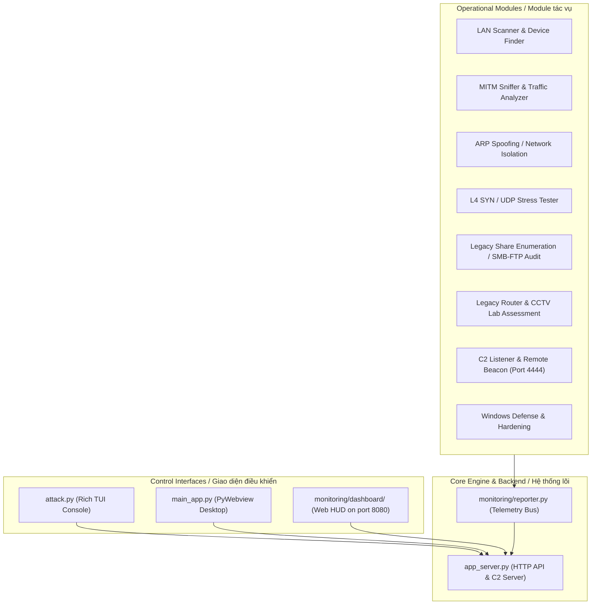

# REDOPS / NEXUS Network Security & SOC Simulator

Tiếng Việt / English

A network security simulation platform designed for defensive analysis, reconnaissance exercises, SOC monitoring, and authorized lab testing in isolated environments. This repository includes a terminal control interface, web dashboard, and several modules for security simulation, telemetry, and operational training.

Hệ thống mô phỏng an ninh mạng dành cho phân tích bảo vệ, thực hành rà quét trong môi trường lab được ủy quyền, giám sát SOC và kiểm thử mạng trong môi trường cô lập. Repo này bao gồm giao diện điều khiển TUI, dashboard web và nhiều module mô phỏng bảo mật, telemetry và đào tạo vận hành.

Important / Lưu ý quan trọng:
- This repository is for educational, defensive, and authorized lab use only.
- Repo này chỉ dùng cho mục đích học tập, phòng thủ, và kiểm thử trong môi trường lab có phép.
- The "share folder hunter" and "router/CCTV exploit" modules are historical or legacy lab examples, not modern recommended practices.
- Các module "share folder hunter" và "router/CCTV exploit" là ví dụ lịch sử / legacy lab, không phải phương pháp hiện đại nên được dùng với cảnh giác và chỉ trong môi trường lab có kiểm soát.

---

## 1. System architecture / Kiến trúc hệ thống



---

## 2. Module overview / Danh mục module và chức năng

| Module / Module | Execution file / Tệp thực thi | Purpose / Chức năng chính |
|---|---|---|
| LAN Scanner & Device Finder / Quét mạng và định danh thiết bị | `attacks/net_scan.py` | Discovers active hosts, resolves device metadata, identifies vendor OUI, and reviews service information. / Quét dải IP, định danh thiết bị, tra cứu OUI nhà sản xuất và tổng hợp thông tin dịch vụ. |
| MITM Sniffer / Sniffer MITM | `attacks/mitm_sniffer.py` | Captures Layer 2/3 traffic and inspects metadata in a controlled lab environment. / Bắt lưu lượng Layer 2/3 và phân tích metadata trong môi trường lab kiểm soát. |
| ARP Spoofing / Isolation Test / Kiểm thử nhiễm độc ARP | `attacks/arp_vkill.py` | Simulates network isolation or disruption for defensive testing and control validation. / Mô phỏng cô lập mạng hoặc ngắt kết nối cho kiểm thử phòng thủ và xác thực điều khiển. |
| L4 SYN / UDP Stress Tester / Kiểm thử tải L4 | `attacks/l4_stress_tester.py` | Evaluates resilience of services under controlled flood conditions for lab benchmarking. / Đánh giá độ chịu tải của dịch vụ dưới điều kiện flood kiểm soát cho mục đích lab benchmark. |
| Legacy Share Enumeration / SMB-FTP Audit / Kiểm tra share cũ | `attacks/share_hunter.py` | Historical lab-oriented reconnaissance module for simple share discovery and access exposure checks. / Module rà quét share lịch sử, hướng tới môi trường lab, dùng để kiểm tra lộ thông tin hoặc quyền truy cập trong môi trường kiểm soát. |
| Legacy Router & CCTV Lab Assessment / Đánh giá Router & CCTV theo hướng lab cũ | `attacks/router_cve_exploit.py` | Historical proof-of-concept module intended only for isolated lab scenarios and demonstration. / Module chứng minh khái niệm lịch sử, chỉ nên dùng trong lab cô lập và mục đích minh họa. |
| C2 Beacon Listener / Lắng nghe beacon C2 | `attacks/c2_listener.py` | Maintains simulated command-and-control flow for training and telemetry scenarios. / Duy trì luồng C2 mô phỏng cho đào tạo và mô phỏng telemetry. |
| Windows Defense & Hardening / Phòng thủ Windows | `defense/windows_defend.py` | Provides defensive configuration examples such as SMB/LLMNR restrictions and hardening guidance. / Cung cấp ví dụ cấu hình phòng thủ như chặn SMB/LLMNR và hướng dẫn hardening. |

Note / Lưu ý:
- Modules such as share discovery and router/CCTV assessment are labeled as legacy or historical examples. They are not intended as modern operational guidance.
- Các module như share discovery và router/CCTV assessment được gắn nhãn là legacy/historical example. Chúng không phải là hướng dẫn vận hành hiện đại.
- Use only in isolated, authorized lab networks.
- Chỉ sử dụng trong mạng lab cô lập và có ủy quyền rõ ràng.

---

## 3. Project structure / Cấu trúc thư mục

```text
├── attacks/                  # Attack simulation and network testing modules / Mô-đun mô phỏng tấn công và kiểm thử mạng
│   ├── arp_vkill.py          # ARP isolation / network disruption simulation / Mô phỏng cô lập mạng ARP
│   ├── c2_listener.py        # C2 listener / beacon logic / Logic lắng nghe C2 / beacon
│   ├── l4_stress_tester.py   # Layer 4 stress-testing module / Module kiểm thử tải Layer 4
│   ├── mitm_sniffer.py       # Packet capture and traffic analysis / Bắt gói và phân tích lưu lượng
│   ├── net_scan.py           # Local subnet discovery and device inventory / Rà quét subnet và danh mục thiết bị
│   ├── rat_payload.py        # Sample C2 agent payload source / Mã nguồn payload agent C2 mẫu
│   ├── router_cve_exploit.py # Legacy router / CCTV assessment module / Module đánh giá Router/CCTV legacy
│   └── share_hunter.py       # Legacy share enumeration / access discovery / Mô phỏng rà quét share cũ
├── defense/                  # Defensive modules and hardening scripts / Module phòng thủ và script hardening
│   └── windows_defend.py     # Example Windows hardening controls / Ví dụ kiểm soát hardening Windows
├── loot/                     # Extracted artifacts, wordlists, and supporting data / Tài liệu trích xuất, wordlist và dữ liệu hỗ trợ
├── monitoring/               # Dashboard, telemetry, and reporting components / Dashboard, telemetry và thành phần báo cáo
│   ├── dashboard/            # Web frontend (HTML/CSS/JS) / Frontend web (HTML/CSS/JS)
│   │   ├── app.js            # Dashboard logic and API integration / Logic dashboard và tích hợp API
│   │   ├── chart.js          # Visualization library / Thư viện biểu đồ
│   │   ├── index.html        # SOC HUD interface / Giao diện SOC HUD
│   │   ├── style.css         # Styling / cyber dashboard theme / Theme dashboard cyber
│   │   └── vis-network.min.js# Network topology rendering library / Thư viện vẽ topology mạng
│   ├── reporter.py           # Telemetry reporting client / Client báo cáo telemetry
│   └── topology.json         # Network layout and discovered topology / Topology mạng và dữ liệu quét
├── app_server.py             # Backend HTTP service and control APIs / Backend HTTP và API điều khiển
├── attack.py                 # Main TUI control interface / Giao diện điều khiển TUI chính
├── build_payload.py          # Builds the sample C2 payload / Công cụ đóng gói payload C2 mẫu
├── main_app.py               # Desktop app wrapper with webview / Wrapper desktop app bằng webview
├── payload.exe               # Prebuilt sample payload / Payload mẫu đã đóng gói
├── requirements.txt          # Python dependencies / Danh sách dependency Python
├── run.bat                   # Windows launcher script / Script khởi động Windows
└── README.md                 # Project documentation / Tài liệu dự án
```

---

## 4. Requirements and installation / Yêu cầu hệ thống và cài đặt

### Requirements / Yêu cầu:
- Operating System: Windows 10 / 11
- Hệ điều hành: Windows 10 / 11
- Python: 3.10 or newer
- Python: 3.10 trở lên
- Administrator privileges are recommended for raw socket access and network operations
- Đề xuất chạy với quyền Administrator để sử dụng raw socket và thao tác mạng
- Npcap is recommended for stable packet handling on Windows
- Npcap nên được cài đặt để Scapy hoạt động ổn định trên Windows

### Install dependencies / Cài đặt thư viện:

```cmd
pip install -r requirements.txt
```

---

## 5. Launch guide / Hướng dẫn khởi chạy

### Option 1: Run with `run.bat` / Cách 1: Khởi chạy bằng `run.bat`

Double-click `run.bat` to start the environment in a Windows terminal session.

Nhấp đúp chuột vào `run.bat` để khởi động môi trường trong Windows Terminal.

```cmd
run.bat
```

### Option 2: Start the TUI console / Cách 2: Khởi động giao diện TUI

Open Command Prompt or PowerShell with Administrator rights.

Mở Command Prompt hoặc PowerShell với quyền Administrator:

```cmd
python attack.py
```

### Option 3: Start the Desktop App / Cách 3: Khởi động Desktop App

```cmd
python main_app.py
```

### Option 4: Open the Dashboard directly / Cách 4: Mở Dashboard trực tiếp

When the backend is running, open:

Khi backend đang chạy, mở:

```text
http://localhost:8080
hoặc
http://<IP_MAY_THAT>:8080
```

Security note / Lưu ý bảo mật:
- The backend may generate a session token and store it in `monitoring/.api_token` or read it from the `API_AUTH_TOKEN` environment variable.
- Backend có thể sinh token phiên và lưu trong `monitoring/.api_token` hoặc đọc từ biến môi trường `API_AUTH_TOKEN`.
- Use this only in authorized test environments.
- Chỉ sử dụng trong môi trường test được ủy quyền.

---

## 6. C2 protocol and graceful stop / Giao thức C2 và graceful stop

- Framing: all frames use a 4-byte big-endian length prefix, up to 4 MB, to prevent partial reads and AES-GCM failures.
- Framing: mọi frame có 4 byte độ dài big-endian (tối đa 4 MB), giúp tránh `recv()` trả thiếu và lỗi AES-GCM.
- Session manager: `C2Manager` tracks multiple agents, each with a session ID and metadata such as hostname, user, OS, architecture, admin state, and PID.
- Session manager: `C2Manager` quản lý nhiều agent, mỗi session có `session_id` và metadata như hostname, user, OS, architecture, admin state, PID.
- Job execution: `POST /api/c2/exec` returns a `job_id` immediately; the dashboard polls `GET /api/c2/job?id=...` to avoid blocking HTTP requests.
- Job execution: `POST /api/c2/exec` trả về `job_id` ngay lập tức; dashboard poll `GET /api/c2/job?id=...` để tránh treo HTTP khi lệnh chạy lâu.
- Legacy compatibility: older agents without the hello handshake are treated as legacy mode; v2 agents use framing and `hello` / `hello_ack`.
- Legacy compatibility: agent cũ không gửi hello sẽ được nhận ở chế độ legacy; agent v2 dùng framing và handshake `hello` / `hello_ack`.
- Graceful stop: dashboard writes stop flags under `monitoring/stop_flags/<module>.stop`; ARP spoofing and MITM routines check them to restore state cleanly.
- Graceful stop: dashboard ghi cờ dừng trong `monitoring/stop_flags/<module>.stop`; module ARP spoofing và MITM kiểm tra cờ này để khôi phục trạng thái mạng đúng cách.

---

## 7. Rebuilding the payload for the current network IP / Tạo lại payload theo IP mạng đang kết nối

Important / Lưu ý quan trọng:
- The generated `payload.exe` must match the current C2 server IP. If the machine connects to a different network or Wi-Fi/Ethernet interface, rebuild the payload.
- File `payload.exe` phải tương thích với IP máy chủ C2 hiện tại. Nếu máy đang đổi mạng, đổi Wi-Fi/Ethernet, hoặc đổi địa chỉ IP, cần rebuild lại payload.

### How to rebuild / Cách rebuild:

1. Open a terminal in the project root.
2. Mở terminal tại thư mục gốc của project.
3. Run:

```cmd
python build_payload.py
```

4. The script will try to detect the active IPv4 automatically. If it is incorrect, enter the correct C2 IP manually.
5. Script sẽ tự động dò IP IPv4 đang hoạt động. Nếu chưa đúng, bạn nhập lại IP C2 đúng thủ công.
6. After that, it will inject the IP into `attacks/rat_payload.py` and build a new `payload.exe` in the project root.
7. Sau đó, nó sẽ chèn IP vào `attacks/rat_payload.py` và build mới `payload.exe` tại thư mục gốc.

Example / Ví dụ:

```cmd
python build_payload.py
```

If the connected network is `192.168.1.55`, then the payload is generated for that address and will connect to `192.168.1.55` when executed.

Nếu mạng hiện tại là `192.168.1.55`, payload sẽ được tạo với địa chỉ này và khi chạy sẽ kết nối tới `192.168.1.55`.

Useful note / Ghi chú hữu ích:
- If your IP changes, run `python build_payload.py` again before using the exe.
- Nếu IP thay đổi, chạy lại `python build_payload.py` trước khi dùng file exe.
- Keep the generated payload only in an isolated lab environment and only for authorized testing.
- Chỉ giữ và sử dụng payload trong môi trường lab cô lập, có ủy quyền rõ ràng.

---

## 8. Security and usage disclaimer / Tuyên bố về bảo mật và sử dụng

This project is developed strictly for:

- defensive analysis
- educational research
- simulation of SOC, NOC, and network operations
- authorized testing in lab environments

Repo này được phát triển với mục đích rõ ràng:

- phân tích phòng thủ
- nghiên cứu học thuật
- mô phỏng SOC, NOC và vận hành mạng
- kiểm thử được ủy quyền trong môi trường lab

It must not be used:

- to target networks or systems without explicit authorization
- for malicious exploitation or disruption
- for unauthorized access to third-party infrastructure

Nó không được sử dụng để:

- tấn công hoặc nhắm tới mạng/systems mà không có ủy quyền rõ ràng
- khai thác hoặc phá hoại bất hợp pháp
- truy cập trái phép vào hạ tầng của bên thứ ba

---

## 9. Legacy modules / Module lịch sử

Some modules in this repository are intentionally labeled as legacy or historical proof-of-concept components. They may reflect older patterns, outdated methodologies, or discontinued techniques.

Một số module trong repo được gắn nhãn là legacy hoặc historical proof-of-concept. Chúng có thể phản ánh các mẫu cũ, cách thức đã lỗi thời hoặc kỹ thuật không còn được sử dụng hiện nay.

Examples include / Ví dụ bao gồm:
- legacy share enumeration logic / logic rà quét share cũ
- router / CCTV reconnaissance examples / ví dụ reconnaissance Router/CCTV
- older exploit demonstration patterns / mẫu trình diễn exploit cũ

These modules should be treated as educational references only and should not be relied upon as current real-world security guidance.

Các module này chỉ nên được xem như tài liệu học tập và không nên coi là hướng dẫn bảo mật thực tế hiện đại.

---

## 10. Final note / Ghi chú cuối

This repository is best used as a learning, simulation, and security operations training project. The purpose is to practice defensive workflows, monitoring, telemetry, and controlled lab scenarios in a safe and isolated environment.

Repo này nên được coi như một dự án học tập, mô phỏng và đào tạo vận hành bảo mật. Mục tiêu là rèn luyện workflow phòng thủ, giám sát, telemetry và tình huống lab được kiểm soát trong môi trường an toàn và cô lập.

---

"Educational lab use only — not a real-world attack toolkit." 
"Chỉ dùng trong môi trường lab học tập — không phải công cụ tấn công thực tế."
