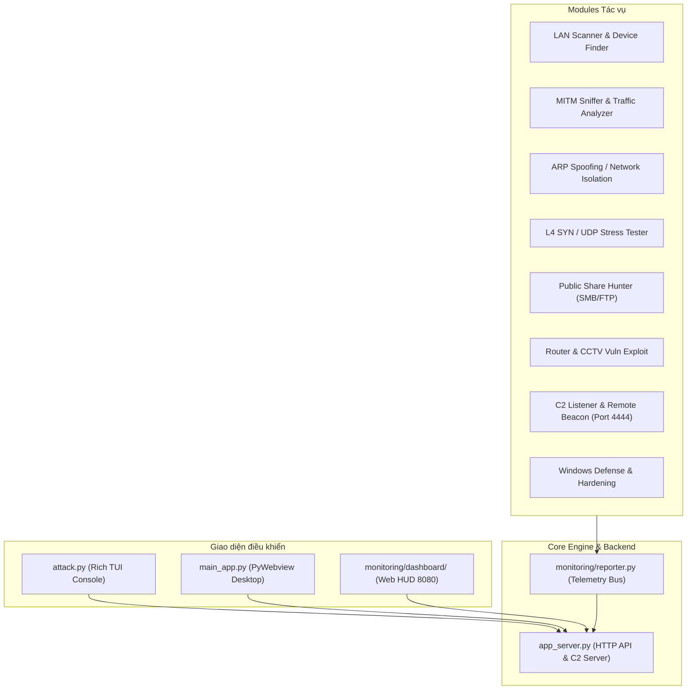

# REDOPS / NEXUS Network Security & SOC Simulator

Hệ thống mô phỏng an ninh mạng, rà quét thiết bị, đánh giá lỗ hổng và giám sát SOC/C2 thời gian thực. Hệ thống tích hợp giao diện điều khiển TUI Terminal và Web Dashboard Cyber HUD, cho phép quản lý toàn diện các module kiểm thử và phòng thủ mạng nội bộ (LAN).

---

## 1. Kiến trúc hệ thống



---

## 2. Danh mục Module & Chức năng

| Module | Tệp thực thi | Chức năng chính |
|---|---|---|
| **LAN Scanner & Device Finder** | `attacks/net_scan.py` | Quét dải IP, định danh thiết bị, tra cứu OUI nhà sản xuất, phân giải tên NetBIOS/mDNS và banner HTTP. |
| **MITM Sniffer** | `attacks/mitm_sniffer.py` | Bắt gói tin Layer 2/3, phân tích tên miền truy vấn, bóc tách ứng dụng (Zalo, Facebook, TikTok) và lưu trữ pcap. |
| **ARP Spoofing (DoS)** | `attacks/arp_vkill.py` | Kiểm thử cô lập mục tiêu hoặc ngắt kết nối diện rộng qua kỹ thuật nhiễm độc bộ nhớ đệm ARP (ARP Cache Poisoning). |
| **L4 SYN / UDP Stress Tester** | `attacks/l4_stress_tester.py` | Đánh giá năng lực chịu tải mạng bằng luồng gói tin TCP SYN và UDP flood đa luồng có kiểm soát. |
| **Public Share Hunter** | `attacks/share_hunter.py` | Rà quét cổng 445/21, phát hiện các thư mục chia sẻ SMB không đặt mật khẩu hoặc FTP nặc danh. |
| **Router & CCTV Vuln Exploit** | `attacks/router_cve_exploit.py` | Kiểm tra lỗ hổng cấu hình và xác thực mặc định trên các dòng Router/Camera (Dahua, Hikvision, v.v.). |
| **C2 Beacon Listener** | `attacks/c2_listener.py` | Máy chủ đón kết nối ngược tại Port 4444, xác thực HMAC-SHA256, mã hóa AES-256-GCM, framing độ dài (protocol v2), nhiều session song song. |
| **Windows Defense & Hardening** | `defense/windows_defend.py` | Tắt LLMNR và chặn SMB 445 / NetBIOS 139. Bộ hardening 9 bước nằm trong `defender.py` và hiện chỉ chạy qua menu TUI. |

---

## 3. Cấu trúc thư mục

```text
├── attacks/                  # Mã nguồn các module kiểm thử tấn công & rà quét
│   ├── arp_vkill.py          # Module cô lập mạng ARP
│   ├── c2_listener.py        # Logic lắng nghe C2 độc lập
│   ├── l4_stress_tester.py   # Kiểm thử tải Layer 4
│   ├── mitm_sniffer.py       # Sniffer & bóc tách lưu lượng
│   ├── net_scan.py           # Quét subnet & thiết bị
│   ├── rat_payload.py        # Mã nguồn mẫu của Agent C2
│   ├── router_cve_exploit.py # Kiểm tra lỗ hổng Router/CCTV
│   └── share_hunter.py       # Quét ổ chia sẻ mạng
├── defense/                  # Module phòng thủ
│   └── windows_defend.py     # Script gia cố tường lửa & dịch vụ
├── loot/                     # Dữ liệu trích xuất, danh sách từ điển & mật khẩu
├── monitoring/               # Tài nguyên Dashboard Web & Telemetry
│   ├── dashboard/            # Mã nguồn Frontend (HTML5, CSS HUD, JavaScript)
│   │   ├── app.js            # Xử lý sự kiện, REST API & C2 Terminal
│   │   ├── chart.js          # Thư viện vẽ biểu đồ lưu lượng
│   │   ├── index.html        # Giao diện SOC Cyberpunk HUD
│   │   ├── style.css         # Bộ stylesheet HUD & hiệu ứng CRT
│   │   └── vis-network.min.js# Thư viện vẽ đồ thị hình sao mạng LAN
│   ├── reporter.py           # Thư viện client báo cáo trạng thái về Backend
│   └── topology.json         # Sơ đồ topology mạng sau khi quét
├── app_server.py             # HTTP Backend thống nhất (Port 8080) & C2 Listener (Port 4444)
├── attack.py                 # Menu điều khiển chính dạng Text User Interface (Rich TUI)
├── build_payload.py          # Công cụ đóng gói Agent C2 ra file thực thi (.exe)
├── main_app.py               # Ứng dụng Desktop chạy Webview
├── payload.exe               # File Agent C2 đã biên dịch sẵn
├── requirements.txt          # Danh sách thư viện Python phụ thuộc
└── run.bat                   # Kịch bản khởi chạy tự động với quyền Administrator
```

---

## 4. Yêu cầu hệ thống & Cài đặt

### Yêu cầu:
* Hệ điều hành: Windows 10 / 11 (yêu cầu quyền **Administrator** để thao tác raw socket và cấu hình card mạng).
* Python: Phiên bản 3.10 trở lên.
* Npcap: Cần cài đặt [Npcap](https://npcap.com/) ở chế độ *"Install Npcap in WinPcap API-compatible Mode"* để Scapy hoạt động ổn định.

### Cài đặt thư viện:
```cmd
pip install -r requirements.txt
```

---

## 5. Hướng dẫn khởi chạy

### Cách 1: Khởi chạy nhanh qua kịch bản `run.bat` (Khuyên dùng)
Nhấp đúp chuột vào `run.bat`. Kịch bản sẽ tự động kiểm tra quyền Admin, yêu cầu cấp quyền UAC nếu cần và mở menu console trong Windows Terminal:
```cmd
run.bat
```

### Cách 2: Khởi chạy giao diện dòng lệnh TUI
Mở Command Prompt hoặc PowerShell với quyền Administrator:
```cmd
python attack.py
```

### Cách 3: Khởi chạy Desktop App (Webview GUI)
```cmd
python main_app.py
```

### Cách 4: Truy cập Web Dashboard trực tiếp
Khi `attack.py` hoặc `app_server.py` đang chạy, mở trình duyệt và truy cập:
```text
http://localhost:8080
hoặc
http://<IP_MAY_THAT>:8080
```
> **Lưu ý bảo mật:** Backend sinh token phiên và lưu tại `monitoring/.api_token` (hoặc dùng biến môi trường `API_AUTH_TOKEN`). Token được chèn thẳng vào `<meta name="api-token">` khi serve `index.html`, nên dashboard mở từ máy khác dùng đúng token mà không cần hardcode. Các endpoint `GET /api/logs`, `/api/findings`, `/api/topology`, `/api/c2/status`, `/api/jobs` đều yêu cầu token khi truy cập từ xa; request từ localhost được miễn.

---

## 5.1. C2 protocol v2 & graceful stop

- **Framing:** mọi frame có 4 byte độ dài big-endian (tối đa 4 MB), tránh `recv()` trả thiếu và AES-GCM decrypt fail.
- **Session manager:** `C2Manager` giữ nhiều agent, mỗi session có `session_id`, metadata (hostname/user/OS/arch/admin/PID), chọn và đóng session từ dashboard.
- **Job exec:** `POST /api/c2/exec` trả `job_id` ngay; dashboard poll `GET /api/c2/job?id=...`, không treo HTTP khi lệnh lâu.
- **Tương thích agent cũ:** agent v1 không gửi hello sẽ được server nhận ở chế độ legacy (không framing). Agent v2 bắt tay bằng frame `hello` và nhận `hello_ack`.
- **Graceful stop:** dashboard ghi cờ `monitoring/stop_flags/<module>.stop`; ARP Spoofing và MITM kiểm tra cờ mỗi vòng lặp để chạy `finally` (restore ARP / tắt IP forwarding) trước khi bị kill sau 20 giây.
- **Job control:** mỗi module có `job_id`, trạng thái, PID, target, exit code; xem ở tab **Module Jobs** hoặc `GET /api/jobs`.

---

## 6. Đóng gói Agent C2 (`payload.exe`)

Để tạo payload kết nối ngược về máy chủ C2 của bạn:
1. Chạy công cụ:
   ```cmd
   python build_payload.py
   ```
2. Nhập địa chỉ IPv4 máy chủ C2 (hoặc nhấn Enter để tự động nhận diện IP máy hiện tại).
3. Tệp thực thi `payload.exe` sẽ được tạo tại thư mục gốc với cơ chế mã hóa AES-256-GCM và bắt tay HMAC-SHA256.
